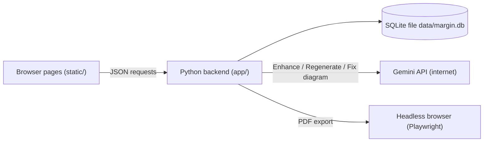

# How Margin works

A guide to the code for someone new to it. It follows a note on its journey from the keyboard to a PDF, and points to the file that does each step. You don't need to read it all at once.

---

## 1. The big picture

Margin has two halves that run on your computer:

- **The frontend**: the pages you see in the browser. Plain **HTML** (structure), **CSS** (looks) and **JavaScript** (behaviour), in `static/`.
- **The backend**: a small **Python** program (FastAPI) in `app/`. It stores notes in a database file, talks to Gemini, and makes PDFs.

They talk through an **API**: the browser sends a request like *"save this text for note 7"* to an address such as `/api/notes/7`, and the backend answers with JSON (structured data).



`start.py` (Windows, Linux and macOS) sets things up and starts the backend; the backend also serves the pages, so one program does everything. `run.sh` and `run.bat` are just shortcuts to `start.py`.

**Starting and stopping as an app.** `start.py --app` starts the backend in the background with `MARGIN_AUTO_STOP=1` and opens a Chrome/Edge window in app mode. Every open page sends a small "still here" request (`/api/heartbeat`, in `js/ui.js`) every 30 seconds; `app/lifecycle.py` stops the backend when nothing has checked in for 3 minutes, so it ends by itself after the last window closes. *Quit Margin* (`start.py --quit`) asks it to stop immediately via `/api/shutdown`, which only this computer may call.

---

## 2. Where things are

```
start.py             launcher: setup, run, app window, shortcuts (Windows/Linux/macOS)
run.sh, run.bat      shortcuts to start.py for Linux/macOS and Windows
app/
  lifecycle.py       "still here" signal and stopping by itself
  main.py            starts the app, adds security headers, maps page addresses to HTML files
  config.py          settings from .env (API key, model names, port, limits)
  db.py              database tables, search index, small upgrades for old databases
  schemas.py         the exact shape every request must have (checked automatically)
  routes/
    notes.py         /api/notes: list, search, create, save, delete, enhance, regenerate, PDF
    subjects.py      /api/subjects: add, rename, delete
    settings.py      /api/settings, /api/backup, /api/restore
  services/
    llm.py           the only file that talks to Gemini
    prompts.py       the written instructions sent with your notes
    enhance.py       the reply format, and turning replies into editor blocks
    pdf.py           making the PDF
static/
  index.html + js/library.js       Library page
  note.html  + js/note.js          Note page (with js/editor.js, js/sections.js, js/diagrams.js)
  export.html + js/export.js       Export page
  print.html + js/print.js         Print layout used only to make PDFs
  settings.html + js/settings.js   Settings page
  js/blocks/                       custom editor blocks: callout, formula, diagram, flashcards
  js/api.js, js/ui.js, js/subjects.js   small shared helpers
  css/tokens.css     all colours, fonts and spacing in one place
  vendor/            libraries bundled with the app (editor, KaTeX, Mermaid)
tests/               automated tests (run with .venv/bin/pytest)
```

---

## 3. A note's journey

### Step 1: Typing and autosave

1. You type in the rough-notes box on the note page.
2. `static/js/note.js` waits until you pause for about 0.7 s (`debounce`), then works out **only what changed** (`changes()`).
3. It sends that to the backend: `PATCH /api/notes/7` with e.g. `{"rough_text": "..."}`.
4. `app/routes/notes.py` → `update_note()` checks the data against `NoteUpdate` in `schemas.py` (for example, rough notes may not be longer than 20,000 characters) and writes it to the `notes` table.
5. The status at the top changes to *Saved*. If the request fails, it shows *Not saved · Retry* and tries again every few seconds.

A brand-new note is only created (`POST /api/notes`) once you type something, so empty notes never pile up.

### Step 2: Enhance notes

1. You press **Enhance notes**. `note.js` first makes sure everything is saved, then sends `POST /api/notes/7/enhance` with your options (`simplify`, `diagrams`, `flashcards`, `applications`, `detail`).
2. `notes.py` → `enhance_note()`:
   - reads the saved note from the database;
   - builds a "fingerprint" (`source_hash`) of the notes and options. If nothing changed since last time it answers *409 unchanged* and the page asks *"Enhance again anyway?"*, which saves your daily quota;
   - builds the request text with `prompts.build_prompt()`: the instructions in `prompts.SYSTEM` + the detail level + the add-ons + your title, subject, topic and rough notes.
3. `services/llm.py` → `generate_json()` sends it to Gemini and asks for **JSON in a fixed format** (the `EnhancedNotes` class in `enhance.py`: sections → blocks → takeaways → flashcards). It also:
   - switches to the lighter fallback model if the main one is overloaded;
   - asks once more if the reply doesn't match the format;
   - turns every error into a plain message (*Service is busy*, *Daily limit reached* …) instead of a technical one.
4. `enhance.py` → `to_editor()` converts the reply into **editor blocks** (heading, paragraph, list, callout, formula, diagram, table, code, flashcards). Text is escaped first, so nothing in a reply can inject code into the page; only **bold**, *italic* and `code` become formatting.
5. Back in the browser, `js/diagrams.js` → `repairDiagrams()` checks each diagram with Mermaid. A diagram that doesn't parse gets one automatic fix (`POST /api/notes/diagrams/fix`).
6. The blocks are shown in the editor (`js/editor.js`, built on Editor.js) and saved with the note (`content_json` column). The result is **not saved by the server**: the page saves it. That's why **Cancel** really cancels.

### Step 3: Editing and regenerating

- Every edit in the enhanced notes is saved like the rough notes, and the note is marked *edited*, so Margin asks before replacing your changes.
- **Undo** keeps the previous version in the page for 15 seconds after a regenerate or a re-enhance (`toast(..., { action })` in `js/ui.js`, used in `note.js`).
- **Regenerate** (`js/sections.js`) finds the blocks between one section heading and the next, and sends only them to `POST /api/notes/7/regenerate-section`, together with your request ("Simpler"…) and a list of what the other sections already cover (so nothing is repeated). The new blocks replace just that section.
- Custom blocks live in `static/js/blocks/`. Each is a small class with `render()` (build the HTML), `save()` (return its data) and `validate()`. `sanitize.js` strips any HTML that isn't simple formatting.

### Step 4: PDF export

1. **Preview & export** opens the export page. `js/export.js` asks for `GET /api/notes/7/pdf?toc=1&size=medium...`.
2. `services/pdf.py` → `render()` starts a **headless browser** (a browser with no window): the Chrome, Edge or Chromium already installed, controlled by Playwright (`launch_options()` lists the order). It opens `/notes/7/print`, a special page (`print.html` + `js/print.js` + `css/print.css`) that lays the note out on A4 paper and draws the formulas and diagrams.
3. Page numbers in the table of contents: a browser can't print them by itself, so `pdf.py` prints the note once, reads the PDF with **pypdf** to see which page each heading landed on, fills the numbers in, and prints again.
4. The PDF bytes go back to the export page, which shows them in the browser's PDF viewer. **Download PDF** saves that same file.

---

## 4. The database

One file: `data/margin.db` (SQLite). Tables (see `app/db.py`):

| Table | What it holds |
|---|---|
| `subjects` | id, name (unique, ignoring capitals) |
| `notes` | title, topic, subject, rough notes, enhanced notes (`content_json`), options used, fingerprint, edited flag, dates |
| `notes_fts` | a full-text search index, kept up to date automatically by database triggers |
| `tags`, `note_tags` | tag names, and which note has which tag (unused tags are deleted automatically) |
| `settings` | default options for new notes |

Deleting a subject never deletes notes: `ON DELETE SET NULL` turns them into *No subject*.

**Backup** (`/api/backup`) writes all of this to one JSON file. **Restore** checks the whole file first and then imports it inside a *transaction*, so a damaged file can never leave your library half-replaced.

---

## 5. Safety measures (and why)

| Measure | Where | Why |
|---|---|---|
| Server only listens on `127.0.0.1` | `config.py` | Other devices can't open your notes |
| Allowed host names only | `main.py` (TrustedHostMiddleware) | Blocks a trick ("DNS rebinding") where a website pretends to be your computer |
| Content-Security-Policy header | `main.py` | Pages may only load scripts from Margin itself |
| API key only in `.env`, read by the backend | `config.py`, `llm.py` | The key never reaches the browser or GitHub |
| Every request checked against a schema | `schemas.py` | Wrong or oversized data is rejected with a clear message |
| Replies escaped, editor HTML sanitized, Mermaid in strict mode | `enhance.py`, `blocks/sanitize.js`, `diagrams.js` | Text from outside can't run code in your browser |
| Notes treated as content, not instructions | `prompts.py` | Text in your notes can't change what the model is told to do |

---

### Phone access

When `MARGIN_PHONE_ACCESS=on`, the server listens on the home network instead of only on the laptop. `app/auth.py` then checks every request (`require_pin` in `main.py`):

- requests from the laptop itself (address `127.0.0.1`) are always allowed;
- any other device must have a sign-in cookie, which it gets by entering the PIN on `/unlock`. The cookie holds an expiry date and a signature made with a secret stored in `data/.session-secret`, so it can't be forged. *Sign out all phones* replaces that secret, which makes every existing cookie invalid at once;
- wrong PINs are counted per device; after 5 the device must wait 5 minutes.

PDF export always opens the print page through `127.0.0.1`, so it works even when a phone asked for the PDF.

---

## 6. Common changes

| I want to… | Change this |
|---|---|
| Change colours or fonts | `static/css/tokens.css` (light and dark sections) |
| Change how notes are written (tone, length, rules) | `SYSTEM` and `DETAIL` in `app/services/prompts.py` |
| Use another Gemini model | `GEMINI_MODEL=` in `.env`, then restart |
| Switch to another provider | Rewrite `generate_json()` in `app/services/llm.py`; nothing else needs to change |
| Change the PDF layout | `static/css/print.css` (and `static/js/print.js` for structure) |
| Change how long phones stay signed in, or the lockout | `COOKIE_DAYS`, `MAX_FAILURES`, `LOCKOUT_SECONDS` in `app/auth.py` |
| Add a new option checkbox | Add the field to `EnhanceOptions` (`enhance.py`), a line in `ADD_ONS` (`prompts.py`), the checkbox in `note.html` and `settings.html`, and its name in `readOptions`/`writeOptions` (`note.js`) and `OPTION_KEYS` (`settings.js`) |

After changing Python files, restart Margin (*Quit Margin* or Ctrl+C, then start it again). After changing HTML, CSS or JavaScript, just reload the page.

---

## 7. Tests

```bash
.venv/bin/pip install -r requirements-dev.txt   # once
.venv/bin/pytest                                # runs everything in tests/
```

The tests use a temporary database and a stand-in for Gemini, so they're fast, never touch your notes, and never use your quota. Run them after any change to the Python code.
